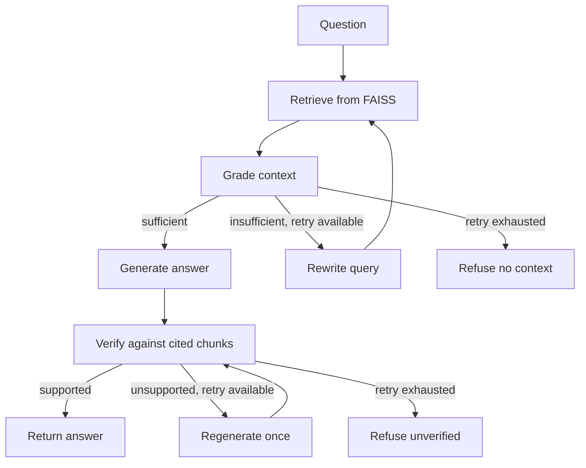

# Commtel Networks — Local RAG Q&A Assistant

A local-first RAG implementation using LangGraph, Sentence Transformers, FAISS, Ollama and FastAPI.

**Important honesty note:** This ZIP contains source code and a focused local corpus extract. It has not been executed on your Windows target machine, so no latency, offline-readiness, or accuracy result is claimed. Model weights must be cached before the offline test. The corpus files are curated extracts, not complete mirrors of the official documentation sites; see the limitations section and verify/extend them before submission.

## Corpus and sources
- Python 3.12 `csv`: https://docs.python.org/3.12/library/csv.html
- Python 3.12 `pathlib`: https://docs.python.org/3.12/library/pathlib.html
- pandas 2.2.3 IO tools: https://pandas.pydata.org/pandas-docs/version/2.2.3/user_guide/io.html
- pandas 2.2.3 `read_csv`: https://pandas.pydata.org/pandas-docs/version/2.2.3/reference/api/pandas.read_csv.html

The Python `csv` and pandas IO docs overlap on CSV reading. The local extracts include table-shaped parameter/dialect data, similar API entries, and version notes. They are focused snapshots for the supplied evaluation set, not the full documentation sets required for a strongest possible submission.

## Windows setup (Python 3.14)
The dependency pins in this ZIP target CPython 3.14.x on Windows x86-64. FAISS 1.16.0 publishes a CPython 3.14 Windows x86-64 wheel, and Sentence Transformers 6.3.0 is a Python 3 universal wheel. This is a compatibility-oriented dependency update; it has **not** been installed or runtime-tested on the candidate's Windows machine.

From the project root in Command Prompt:
```cmd
py -3.14 -m venv .venv
.venv\Scripts\activate
python --version
python -m pip install --upgrade pip
python -m pip install -r requirements.txt
```
Expected Python output: `Python 3.14.x`. If `py -3.14` is not found, run `py --list` and select the installed 3.14 runtime. Do not use `py -3.14.6`; the launcher selector uses major.minor.

If package installation fails, capture the **first** `ERROR:` block and `python -m pip debug --verbose`; do not randomly upgrade packages. The exact FAISS wheel support is documented on [PyPI](https://pypi.org/project/faiss-cpu/1.16.0/).
If activation is blocked:
```powershell
Set-ExecutionPolicy -Scope Process -ExecutionPolicy Bypass
.\.venv\Scripts\Activate.ps1
```

## Local models (one-time setup while online)
Install Ollama from https://ollama.com/download/windows, then:
```cmd
ollama pull qwen2.5:3b
```
Ollama Desktop normally starts its local service automatically. If it is not running, start `ollama serve` in a separate terminal. Verify with `ollama list` and `curl http://localhost:11434/api/tags`.

In the activated project environment:
```cmd
python scripts\prepare_models.py
```
The embedding model is `sentence-transformers/all-MiniLM-L6-v2`. Keep both model caches before disconnecting the network. Runtime calls Ollama only at `127.0.0.1`; Hugging Face offline flags are set in the application.

## Ingest and run
```powershell
python ingest.py
uvicorn commtel_rag.api:app --app-dir src --host 127.0.0.1 --port 8000
```
Swagger: http://127.0.0.1:8000/docs

Example:
```powershell
Invoke-RestMethod -Method Post -Uri http://127.0.0.1:8000/query -ContentType "application/json" -Body '{"question":"What does pathlib.Path.read_text return?"}'
Invoke-RestMethod http://127.0.0.1:8000/documents
```

## Evaluate
```powershell
python evaluate.py
```
Generates `results.jsonl` and `reports/evaluation_summary.json`. It calculates retrieval hit rates, refusal counts, and latency. Groundedness requires manual review; use `reports/groundedness_review_template.csv`. Never report invented metrics.

## Offline validation checklist
1. Cache Qwen2.5-3B in Ollama and all-MiniLM-L6-v2 locally.
2. Run ingestion.
3. Verify `data/index/chunks.faiss` and `chunks.json`.
4. Disconnect network and run Ollama locally.
5. Test `/documents`, `/query`, and `python evaluate.py`.
6. Record hardware, median latency and p95 latency from the actual run.

## Architecture


## Deliverables included
- `ingest.py`, `evaluate.py`
- `src/commtel_rag/` package with typed LangGraph workflow and FastAPI
- `data/docs/` local documentation extracts
- `questions.jsonl` with required 20-question category distribution
- `config.yaml`, pinned `requirements.txt`
- `graph.mmd`, technical report template, manual review template

## Known limitations to disclose
- Corpus is curated and not a complete mirror of the official docs. Replace with full pinned official HTML snapshots if possible, then rerun all measurements.
- Local LLM grading and verification are probabilistic.
- CPU latency depends on the target host and Ollama settings; no performance claim is made here.
- Complete the report's three failure traces and manual groundedness review from real execution.
- This ZIP has no fabricated Git history. `GIT_SEQUENCE.md` explains how to create a private repository and commit the gold question set before workflow code in your own history.

## AI assistant disclosure
Prepared with ChatGPT assistance for architecture, code drafting and documentation. The candidate must run, inspect, debug and be able to defend all code.
